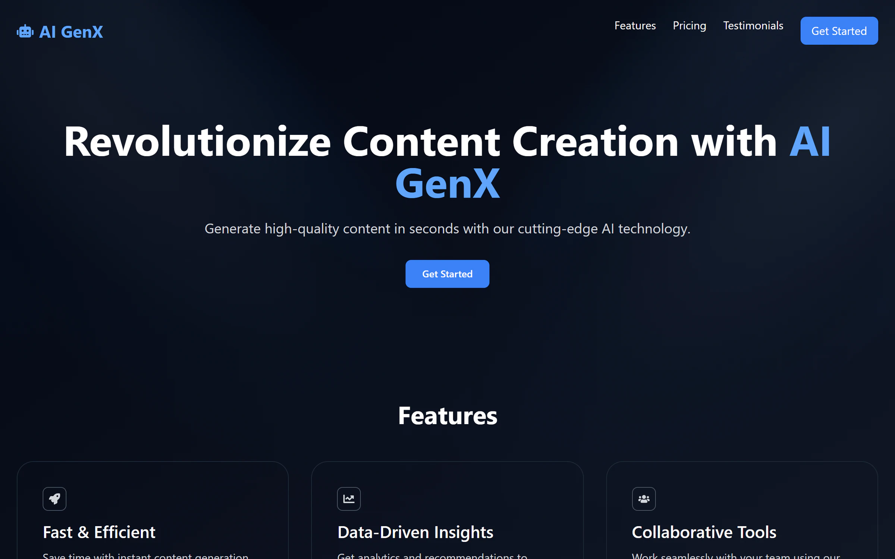

# GenAIX

**An AI content-creation experience with generation, content insights and team collaboration.**

    

## Overview

An AI-powered content-creation experience designed to help teams generate content, review analytics and recommendations, and collaborate on their content workflow.

## The challenge

Powerful generative AI tools are often complex and hard to use.

## The solution

A clean, intuitive interface that brings AI content generation, analytics and team collaboration together.

## Key features

- Fast content generation
- Content analytics and recommendations
- Team collaboration tools

## Tech stack

Next.js · TypeScript · Tailwind CSS

## Live

https://genaix.vercel.app/

## Privacy

Client names and records are confidential. Every screen in this repository uses sample data, and source code that belongs to the client is not published.

## Links

- Case study on Lexvaxa: https://lexvaxa.com/work/genaix
- Built by **Ch Muhammad Samiullah** ([GitHub](https://github.com/samiullah156-creator)) at [Lexvaxa](https://lexvaxa.com)
